# ZE Graph Website


> [!TIP]
> Live at **https://zegraph.xyz** [ⓘ](https://zegraph.xyz "smol vps, be nice :)")

## Description
This track all CS Zombie Escape related servers that I’m aware of, allowing you to view player playtime on each server. 
It was originally created to monitor only the GFL Zombie Escape server, but has since expanded to include several 
servers in the western community. Chinese servers are not tracked due to technical limitations on their servers. Only GFL and 
Mapeadores servers provide Steam IDs, enabling consistent tracking of individual players. Other servers rely solely 
on player names for tracking. Any request for me to track your own server, you can contact me through the provided email
address on the website.

This is codebase is purely for displaying data from the database. Itself does
not store the player data and webscraping. Those are hidden. If you wish to host your own, you would need to implement
your own datascraping mechanism.

## How it works
The scraper (hidden) pulls from all the sources below and dumps everything into the database (PostgreSQL). The backend (Rust) does
the heavy queries on top of it and caches the results in redis so the smol vps doesn't die. The frontend (Next.js)
is the website you see. Radar maps are rendered by QGIS straight from PostGIS, and profile pictures come from 
multiple sources that i wrote originally in Python. Literally ported to Rust for that service tbh.

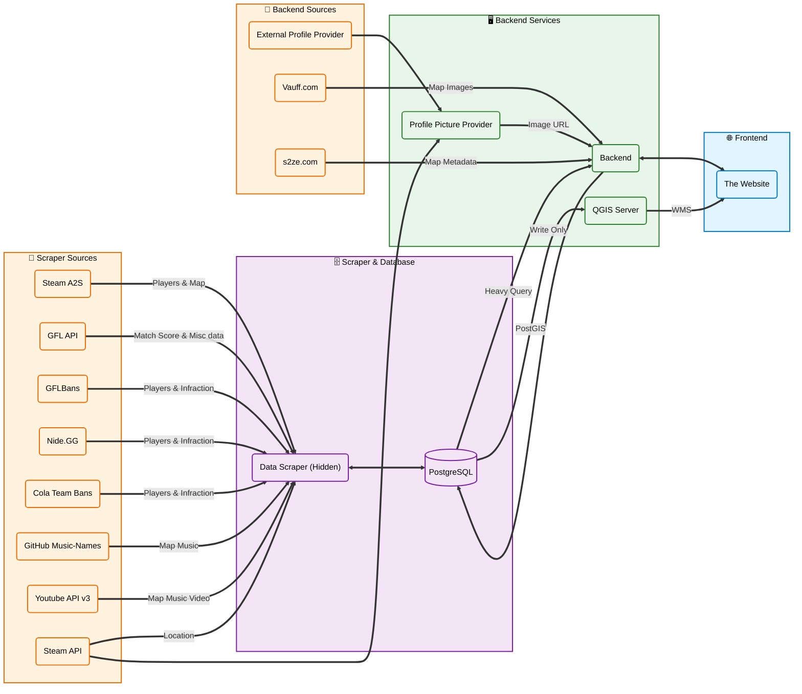
## Deploy
1. Get a PostgreSQL with PostGIS and pg_cron extensions, then run `db.sql` on it.
2. Copy `default.env` to `.env` and fill it in. Inside docker, `localhost` is the container itself, so point
   `REDIS_URL` at `redis://redis:6379/` and `DB_HOST` at `host.docker.internal` if postgres is on the host.
3. Generate VAPID keys for push notifications, and point `VAPIDS_PATH` at `./vapids`:
   ```bash
   openssl ecparam -genkey -name prime256v1 -out vapids/vapid_private.pem
   openssl ec -in vapids/vapid_private.pem -pubout -out vapids/vapid_public.pem
   ```
4. Running it
   ```bash
   docker compose up --build -d                  # production, on port 51020
   docker compose -f compose.dev.yaml up --build # development, on port 3002
   ```

How I actually deploy it (swarm, staging, CI) is all in [deployment/README.md](deployment/README.md).

## Preview
<a href="assets/img.png">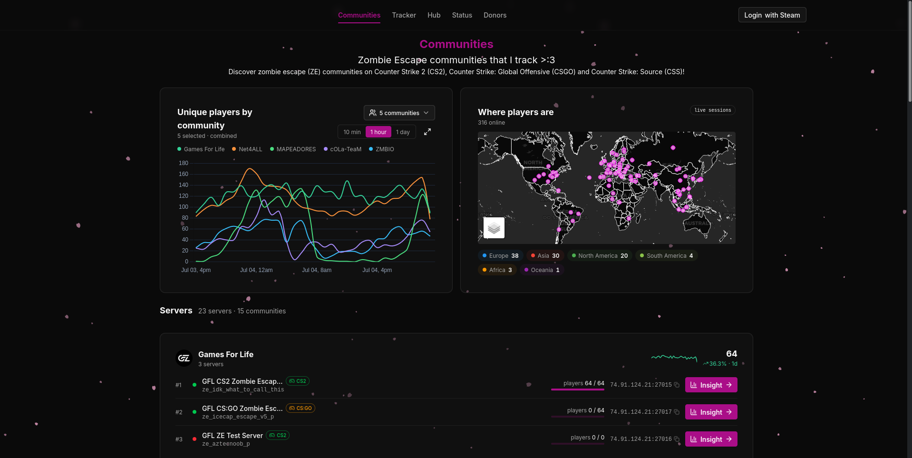</a>

<details>
<summary><b>More pages</b></summary>
<br>

<table>
  <tr>
    <td align="center"><a href="assets/server.png">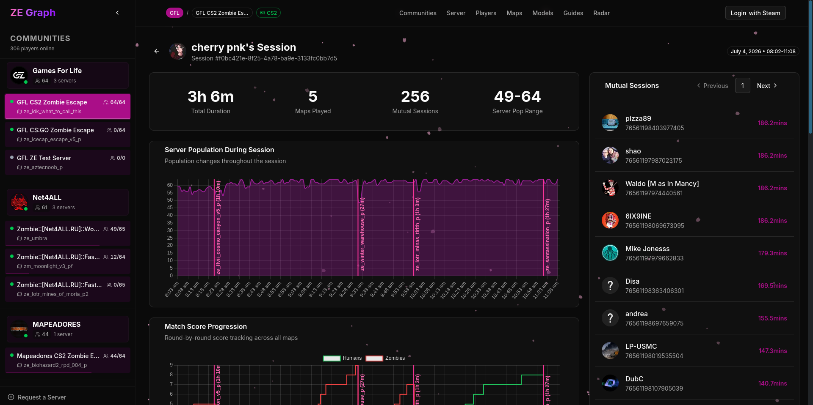</a><br><sub>Server</sub></td>
    <td align="center"><a href="assets/players.png">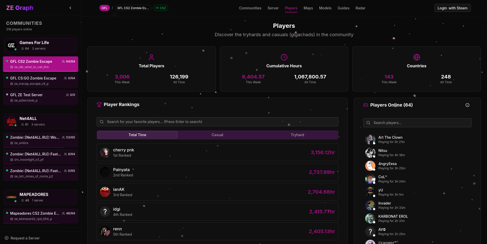</a><br><sub>Players</sub></td>
  </tr>
  <tr>
    <td align="center"><a href="assets/player.png">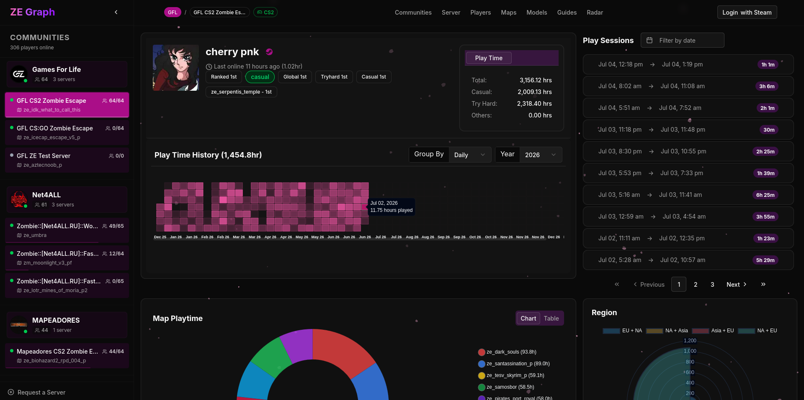</a><br><sub>Player</sub></td>
    <td align="center"><a href="assets/maps.png">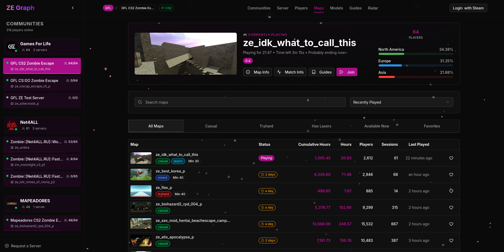</a><br><sub>Maps</sub></td>
  </tr>
  <tr>
    <td align="center"><a href="assets/map.png">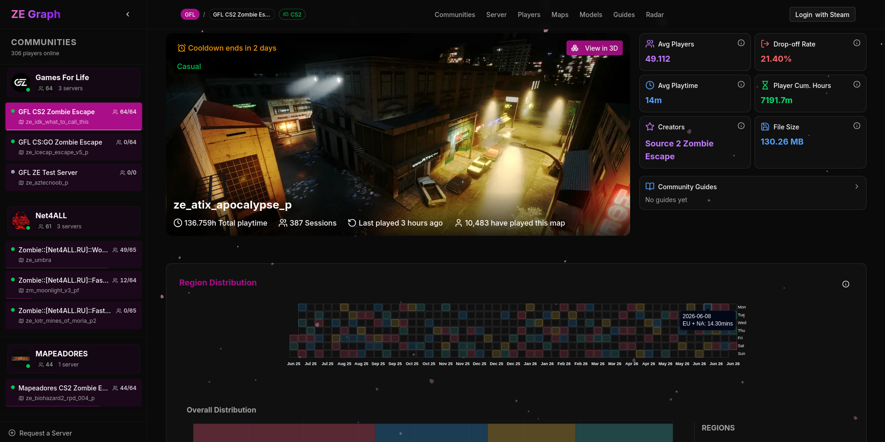</a><br><sub>Map</sub></td>
    <td align="center"><a href="assets/live_radar.png">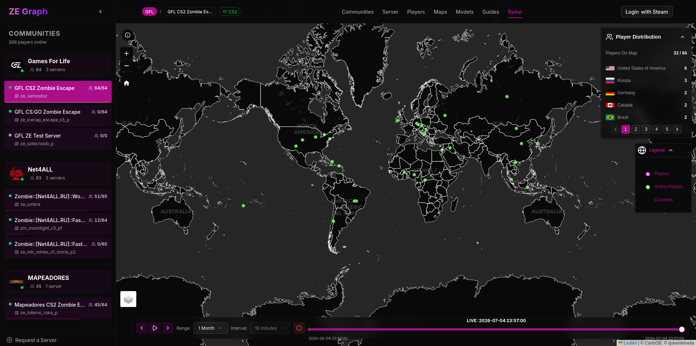</a><br><sub>Live Radar</sub></td>
  </tr>
  <tr>
    <td align="center"><a href="assets/radar_overall.png">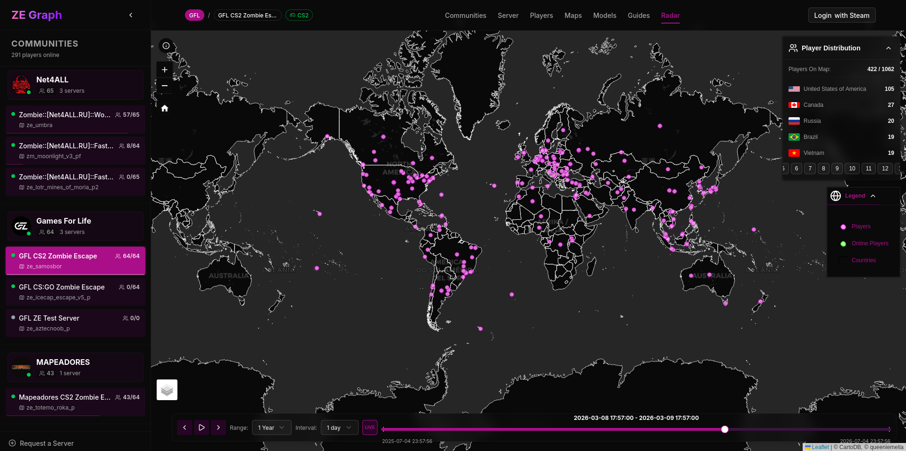</a><br><sub>Radar</sub></td>
    <td align="center"><a href="assets/radar_country.png">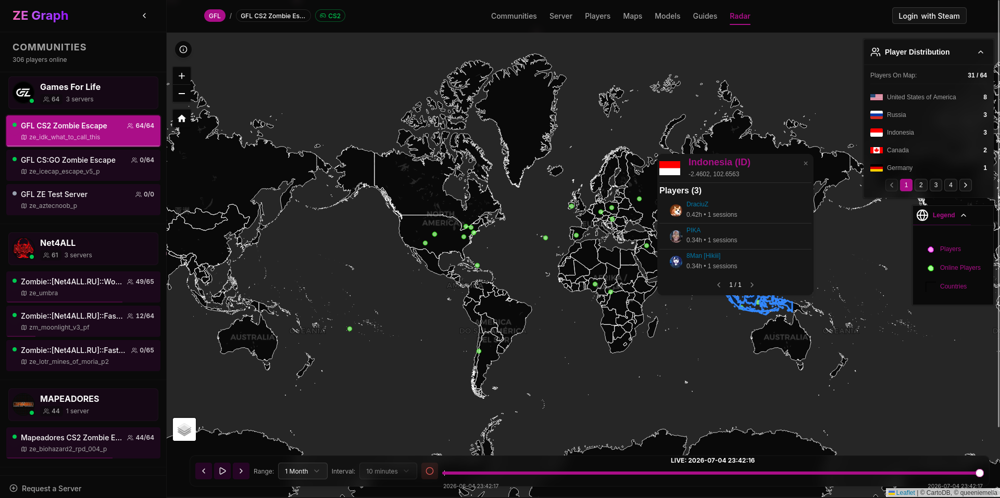</a><br><sub>Radar by Country</sub></td>
  </tr>
  <tr>
    <td align="center"><a href="assets/tracker.png">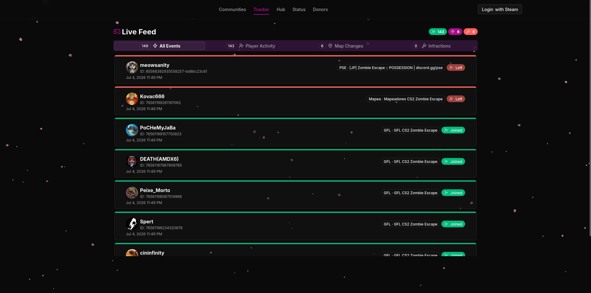</a><br><sub>Tracker</sub></td>
    <td align="center"><a href="assets/3d_viewer.png">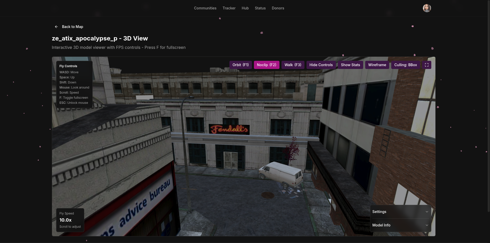</a><br><sub>3D Viewer</sub></td>
  </tr>
  <tr>
    <td align="center"><a href="assets/info_sharing.png">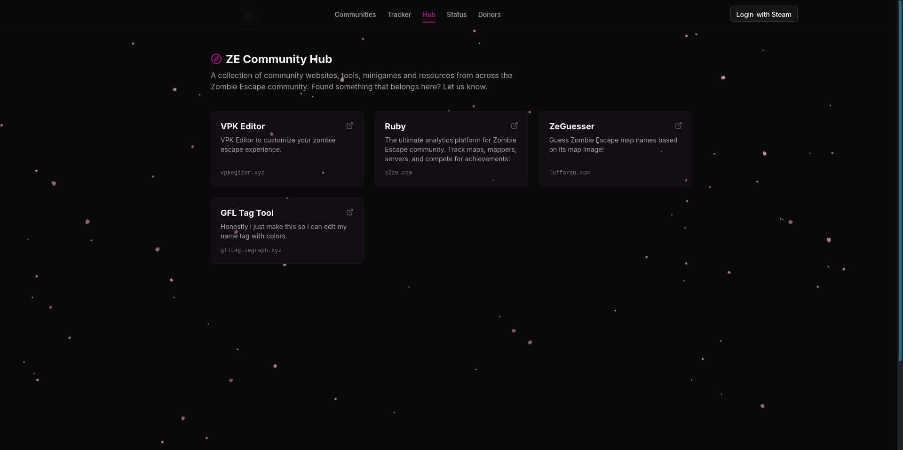</a><br><sub>Info Sharing</sub></td>
    <td align="center"><a href="assets/status.png">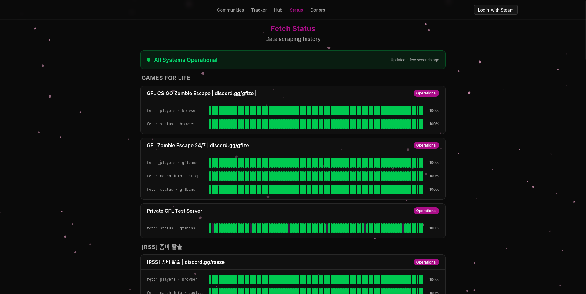</a><br><sub>Statuses</sub></td>
  </tr>
</table>

</details>
